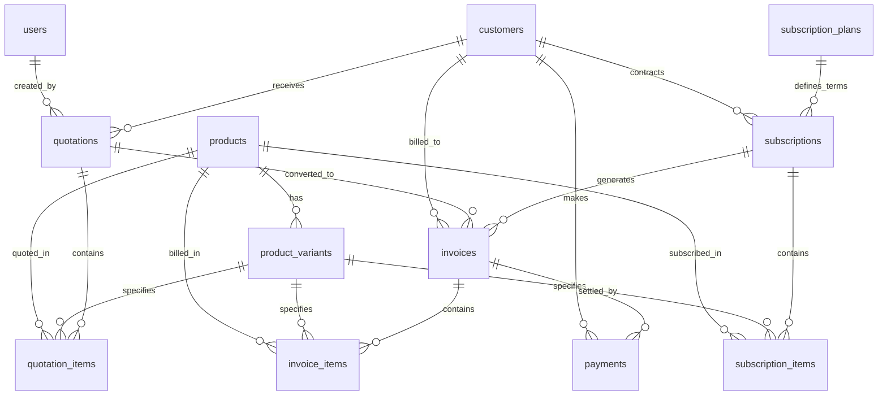
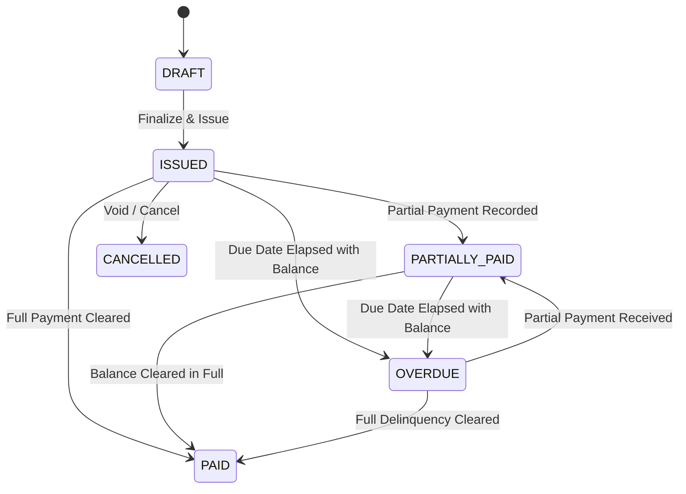
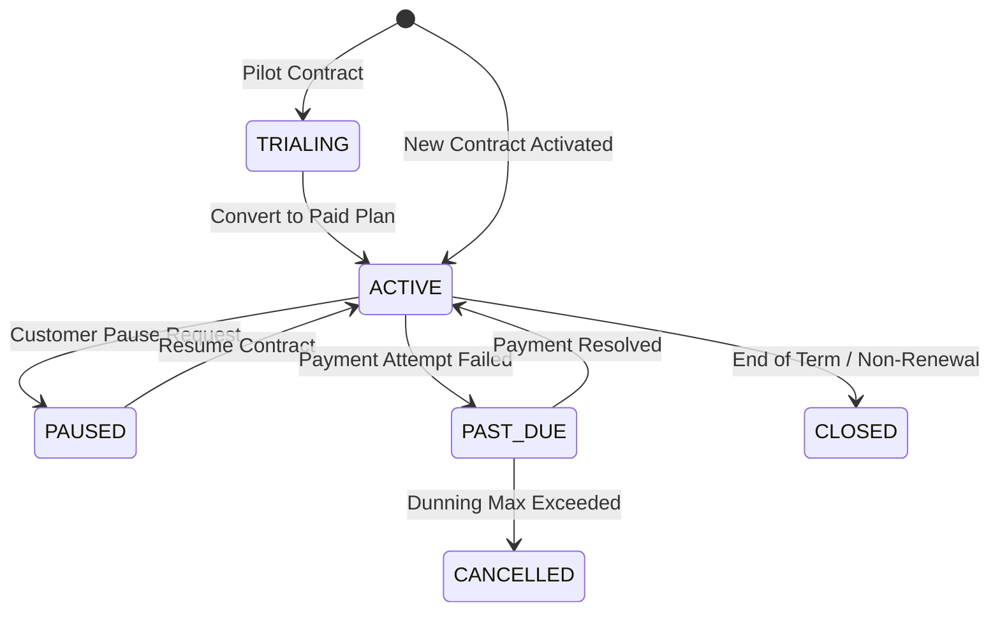

# REVORA Relational Database Schema Documentation

**System**: REVORA — Subscription Revenue Intelligence Platform  
**Engineer**: Krishna (Database, Finance & System Engineer)  
**Dialect**: ANSI SQL-92 / SQLite 3 / PostgreSQL Compatible  
**Last Updated**: October 2026  

---

## 1. Architectural Overview & Entity-Relationship Model

REVORA is architected around a normalized, double-entry-aligned relational database supporting the complete B2B SaaS subscription and revenue lifecycle:

---

## 2. Table Specifications

### 2.1 Core Identity & Access
#### `users`
- **Purpose**: Internal administrative operators, financial controllers, and system services.
- **Primary Key**: `id` (INTEGER, AUTOINCREMENT)
- **Natural Key**: `username` (VARCHAR(50), UNIQUE), `email` (VARCHAR(100), UNIQUE)
- **Security Policy**: Passwords must be hashed using bcrypt or Argon2 prior to insertion. Plain-text credentials are strictly forbidden.
- **Roles**: `ADMIN`, `FINANCE_MANAGER`, `SALES_REP`, `SYSTEM_ENGINEER`, `INTELLIGENCE_ANALYST`.

#### `customers`
- **Purpose**: B2B client organizations purchasing subscriptions, add-ons, and professional services.
- **Primary Key**: `id` (INTEGER, AUTOINCREMENT)
- **Natural Key**: `customer_code` (VARCHAR(50), UNIQUE, e.g. `CUST-001`)
- **Key Fields**: `tax_identifier` (GSTIN / VAT / PAN), `currency` (ISO-4217, default `'INR'`), `status` (`ACTIVE`, `INACTIVE`, `CHURNED`, `SUSPENDED`).

---

### 2.2 Product Catalog & Packaging
#### `products`
- **Purpose**: Master catalog of platform modules, recurring software capabilities, and managed services.
- **Primary Key**: `id` (INTEGER, AUTOINCREMENT)
- **Natural Key**: `product_code` (VARCHAR(50), UNIQUE, e.g. `PROD-REV-CORE`)
- **Categories**: `PLATFORM`, `ANALYTICS`, `INTEGRATION`, `SUPPORT`, `SECURITY`.

#### `product_variants`
- **Purpose**: Granular SKUs representing commercial editions and billing frequencies of a product.
- **Primary Key**: `id` (INTEGER, AUTOINCREMENT)
- **Foreign Keys**: `product_id` -> `products(id)` ON DELETE RESTRICT ON UPDATE CASCADE
- **Natural Key**: `sku` (VARCHAR(50), UNIQUE)
- **Pricing Fields**: `base_price` (DECIMAL(12,2) >= 0.00), `tier` (`STARTER`, `GROWTH`, `PRO`, `ENTERPRISE`), `billing_frequency` (`MONTHLY`, `QUARTERLY`, `ANNUAL`).

#### `subscription_plans`
- **Purpose**: Standardized commercial packages binding products to recurring billing cycles.
- **Primary Key**: `id` (INTEGER, AUTOINCREMENT)
- **Natural Key**: `plan_code` (VARCHAR(50), UNIQUE, e.g. `PLAN-ENT-ANNUAL`)
- **Key Fields**: `billing_cycle` (`MONTHLY`, `QUARTERLY`, `ANNUAL`), `billing_period_days` (INTEGER > 0), `plan_price` (DECIMAL(12,2) >= 0.00).

#### `discounts`
- **Purpose**: Campaign coupons, partner concessions, and negotiated enterprise price breaks.
- **Primary Key**: `id` (INTEGER, AUTOINCREMENT)
- **Natural Key**: `discount_code` (VARCHAR(50), UNIQUE)
- **Key Fields**: `discount_type` (`PERCENTAGE`, `FIXED_AMOUNT`), `value` (DECIMAL(12,2)), `valid_from`, `valid_until` (Constraint: `valid_until >= valid_from`).

---

### 2.3 Quotation & Pre-Sales Pipeline
#### `quotations`
- **Purpose**: Commercial proposals presented to prospective or renewing accounts.
- **Primary Key**: `id` (INTEGER, AUTOINCREMENT)
- **Natural Key**: `quotation_number` (VARCHAR(50), UNIQUE, e.g. `QT-2026-001`)
- **Foreign Keys**: 
  - `customer_id` -> `customers(id)` ON DELETE RESTRICT
  - `created_by` -> `users(id)` ON DELETE SET NULL
- **Statuses**: `DRAFT` -> `SENT` -> `ACCEPTED` / `REJECTED` / `EXPIRED`.
- **Integrity Rule**: `CHECK (total_amount = subtotal - discount_amount + tax_amount)`

#### `quotation_items`
- **Purpose**: Granular line items specifying products, quantities, and line totals for a quotation.
- **Foreign Keys**: `quotation_id` -> `quotations(id)` ON DELETE CASCADE, `product_id` -> `products(id)` ON DELETE RESTRICT.

---

### 2.4 Subscriptions & Recurring Contracts
#### `subscriptions`
- **Purpose**: Legally binding recurring service agreements between REVORA and customers.
- **Primary Key**: `id` (INTEGER, AUTOINCREMENT)
- **Natural Key**: `subscription_code` (VARCHAR(50), UNIQUE, e.g. `SUB-2026-001`)
- **Foreign Keys**:
  - `customer_id` -> `customers(id)` ON DELETE RESTRICT
  - `plan_id` -> `subscription_plans(id)` ON DELETE RESTRICT
- **Statuses**: `TRIALING`, `ACTIVE`, `PAUSED`, `PAST_DUE`, `CANCELLED`, `CLOSED`.
- **Lifecycle Tracking**: `start_date`, `current_period_start`, `current_period_end`, `next_billing_date`, `renewal_count`, `auto_renew`.

#### `subscription_items`
- **Purpose**: Component products, seats, and tier entitlements activated within a subscription.
- **Foreign Keys**: `subscription_id` -> `subscriptions(id)` ON DELETE CASCADE, `product_id` -> `products(id)` ON DELETE RESTRICT.

---

### 2.5 Invoicing & Cash Settlement
#### `invoices`
- **Purpose**: Formal demand for payment generated against active subscriptions or one-time orders.
- **Primary Key**: `id` (INTEGER, AUTOINCREMENT)
- **Natural Key**: `invoice_number` (VARCHAR(50), UNIQUE, e.g. `INV-1042`)
- **Foreign Keys**:
  - `customer_id` -> `customers(id)` ON DELETE RESTRICT
  - `subscription_id` -> `subscriptions(id)` ON DELETE SET NULL
  - `quotation_id` -> `quotations(id)` ON DELETE SET NULL
- **Statuses**: `DRAFT`, `ISSUED`, `PARTIALLY_PAID`, `PAID`, `OVERDUE`, `CANCELLED`.
- **Mathematical Integrity Rules**:
  - `CHECK (discount_amount <= subtotal)`
  - `CHECK (total_amount = subtotal - discount_amount + tax_amount)`
  - `CHECK (amount_paid <= total_amount)`
  - `CHECK (outstanding_amount = total_amount - amount_paid)`

#### `invoice_items`
- **Purpose**: Billed line items detailing products, quantities, tax rates, and totals.
- **Foreign Keys**: `invoice_id` -> `invoices(id)` ON DELETE CASCADE, `product_id` -> `products(id)` ON DELETE RESTRICT.

#### `payments`
- **Purpose**: Settled financial transactions recorded against invoices. Supports split / multi-payments.
- **Primary Key**: `id` (INTEGER, AUTOINCREMENT)
- **Natural Key**: `payment_reference` (VARCHAR(100), UNIQUE, e.g. `PAY-2026-001`)
- **Foreign Keys**:
  - `invoice_id` -> `invoices(id)` ON DELETE RESTRICT
  - `customer_id` -> `customers(id)` ON DELETE RESTRICT
- **Payment Methods**: `BANK_TRANSFER`, `CREDIT_CARD`, `UPI`, `ACH`, `STRIPE`, `RAZORPAY`.
- **Statuses**: `PENDING`, `COMPLETED`, `FAILED`, `REFUNDED`.

---

## 3. Financial Calculation Standards & Validation

All monetary arithmetic adheres to exact accounting definitions:

$$\text{Discounted Amount} = \text{Subtotal} - \text{Discount}$$
$$\text{Total Amount} = \text{Discounted Amount} + \text{Tax}$$
$$\text{Outstanding Amount} = \text{Total Amount} - \text{Amount Paid}$$

### Financial Enforcement Matrix
| Business Rule | Enforced By | Mechanism |
| :--- | :--- | :--- |
| Negative monetary prevention | Database | `CHECK (amount >= 0.00)` |
| Discount cannot exceed subtotal | Database | `CHECK (discount_amount <= subtotal)` |
| Total amount exact match | Database | `CHECK (total_amount = subtotal - discount_amount + tax_amount)` |
| Outstanding amount exact match | Database | `CHECK (outstanding_amount = total_amount - amount_paid)` |
| Amount paid cannot exceed total | Database | `CHECK (amount_paid <= total_amount)` |
| Multi-payment balance cap | Python Backend + DB Triggers | Backend transaction checks `new_payment <= outstanding_amount` before insert |
| Automatic ledger reconciliation | Database Triggers | `trg_payment_after_insert` & `trg_payment_after_update` |
| Overdue state transition | Backend Cron / Queries | Transitions `ISSUED`/`PARTIALLY_PAID` to `OVERDUE` if `due_date < CURRENT_DATE` |

---

## 4. Status State Machines

### 4.1 Invoice Status Workflow

### 4.2 Subscription Status Workflow

